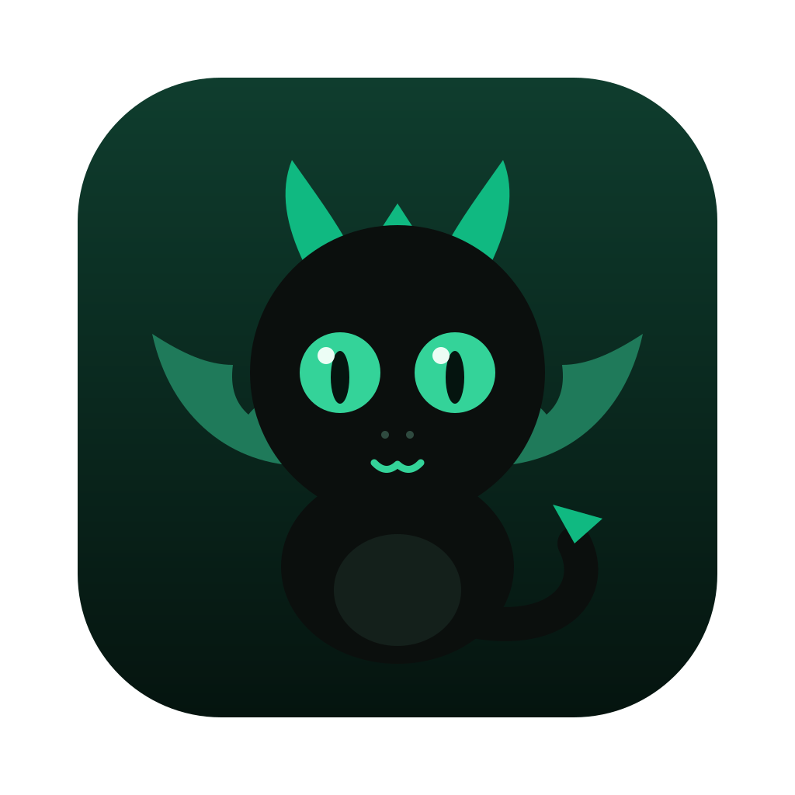

# Drako

Terminali nativi che sopravvivono alle tab. Ogni terminale è una sessione a sé
(PTY + [libghostty-vt](https://github.com/ghostty-org/ghostty), tramite
[zmx](https://github.com/neurosnap/zmx)); un registro SQLite dice in quale tab sta.
Spostare un terminale da una tab all'altra cambia solo il suo "parent": il processo non se ne accorge.

## Build

Serve Zig 0.17.

```sh
zig build -Doptimize=ReleaseSafe   # binario in zig-out/bin/drako
zig build test
```

## Uso

```sh
drako new --tab work                 # stampa l'id, es. 3fa9c1
drako new --tab logs -- tail -f app.log
drako ls [--json]                    # terminali raggruppati per tab
drako attach 3fa9c1                  # ctrl+\ per staccarsi
drako move 3fa9c1 logs
drako kill 3fa9c1
```

## Come funziona

- **Sessione**: ogni terminale è un daemon zmx (`dk-<id>`) con il suo socket Unix. I byte del programma
  arrivano grezzi al client; libghostty-vt tiene una copia dello stato e, al riattacco, rimanda
  schermo e scrollback. Nessun tmux in mezzo.
- **Registro**: `$DRAKO_DB`, altrimenti `$XDG_DATA_HOME/drako/drako.db`
  (default `~/.local/share/drako/drako.db`). Tabelle `tabs` e `terminals(tab_id, position)`.
  Una tab esiste finché contiene almeno un terminale; `ls` dimentica i terminali il cui programma è terminato.
- **Trasporto**: il server non sa da dove arriva l'input. In locale si apre il socket; da remoto
  basta `ssh host drako attach <id>`, anche via Tailscale SSH.

## Non ancora fatto

- Layout degli split dentro una tab (oggi c'è solo l'ordine).
- Eventi in tempo reale per il client grafico (fork di Ghostty).
